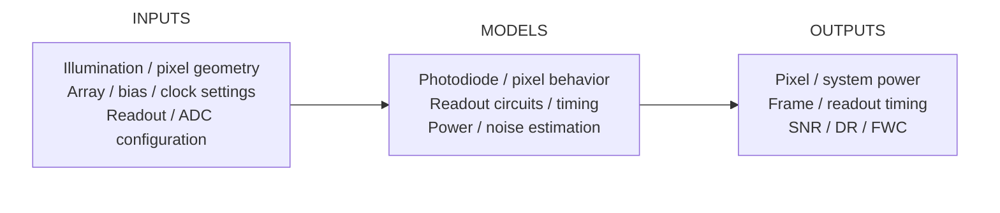
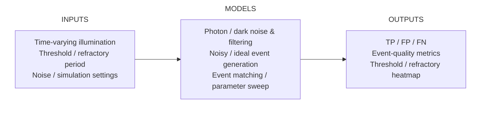
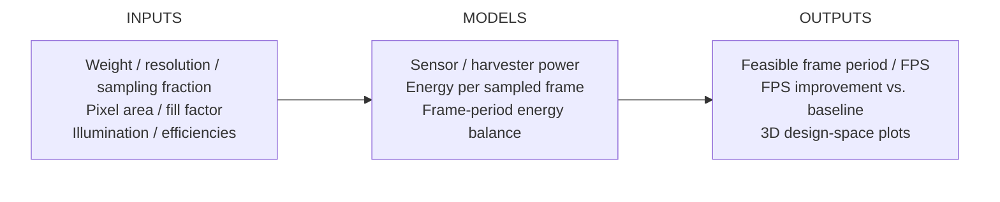

# Quantitative Framework for Novel Image Sensor Architectures for Autonomous Edge Vision

**DAC 2026 Invited Paper** · Presented at DAC 2026 · Proceedings forthcoming

**Paper:** *A Quantitative Approach to Exploring Novel Image Sensor Architectures Towards Autonomous Edge Machine Vision*  
**Authors:** Han Yan, Yifei Zou, Weikai Lin, Yuhao Zhu, and Xuan Zhang  
[Conference presentation](https://63dac.conference-program.com/presentation/?id=SSSN118&sess=sess254) · [Paper](https://horizon-lab.org/publications/)

## Overview

This repository provides parameterized, physics-based modeling tools to examine how image sensor architectures and operating parameters affect **noise, power, timing, and energy efficiency**. The goal is to support rapid, quantitative design-space exploration of conventional and emerging sensors for autonomous edge vision.

## Modeling Framework

### 1. Frame-Based CMOS Image Sensor — [`CIS_Model/`](CIS_Model/)



The CIS model combines pixel-level physical behavior with array and peripheral-circuit models (including readout and ADC components). It estimates system-level metrics from design choices rather than requiring transistor-level simulation for each candidate.

**Supported study cases:** conventional CMOS image sensors, 3D-structured sensors, coded-exposure sensors, and in-sensor/optical-processing architectures. Example configurations are documented in [`CIS_Model/Use_cases/README.md`](CIS_Model/Use_cases/README.md).

### 2. Dynamic Vision Sensor — [`DVS_Noise_Model/`](DVS_Noise_Model/)



The DVS simulator models how illumination and noise propagate through the event-generation process. For a given configuration, it generates **noisy and ideal event traces** and matches them to count true positives (TP), false positives (FP), and false negatives (FN). A parameter sweep explores the trade-off between event threshold and refractory period.

The current heatmap uses the event-matching score

$$
10\log_{10}\left(\frac{\mathrm{TP}}{\mathrm{FP}+\mathrm{FN}}\right)
$$

with small numerical stabilizers in code. This is an **event-fidelity score**, not conventional image-domain SNR. See [`DVS_Noise_Model/README.md`](DVS_Noise_Model/README.md).

### 3. Self-Powered Image Sensor — [`Self_Powered_CIS_Simulator/`](Self_Powered_CIS_Simulator/)



This model evaluates when a sensing design can sustain operation under harvested-power constraints. It estimates the energy available from light harvesting, compares it with sensing energy requirements, and solves for a feasible frame period subject to a minimum integration time. Sweeps over weight, resolution, and sampling fraction reveal achievable FPS and relative improvements over a baseline design.

See [`Self_Powered_CIS_Simulator/README.md`](Self_Powered_CIS_Simulator/README.md).

## Installation & Quick Start

**Requirements:** Python 3, NumPy, pandas, and Matplotlib (listed in [`requirements.txt`](requirements.txt)).

```bash
git clone https://github.com/777yifei/Quantitative-Framework-for-Novel-Image-Sensor-Architectures-for-Autonomous-Edge-Vision.git
cd Quantitative-Framework-for-Novel-Image-Sensor-Architectures-for-Autonomous-Edge-Vision

python3 -m venv .venv
source .venv/bin/activate
python -m pip install -r requirements.txt
```

Run each example independently from the repository root:

```bash
# Frame-based CIS: example sensor configuration
python CIS_Model/Use_cases/Use_case_1_Conventional_CIS.py

# DVS: threshold and refractory-period design-space sweep
(cd DVS_Noise_Model && python dse.py)

# Self-powered CIS: energy-constrained design-space sweep
(cd Self_Powered_CIS_Simulator && python Self-Powered_CIS_Simulator.py)
```

| Example | Expected result |
| --- | --- |
| **CIS model** | Constructs a `CIS_Array` and computes timing, power, and noise properties. Inspect the example or model object to access metrics. |
| **DVS noise sweep** | `DVS_Noise_Model/dse_snr_heatmap.pdf` |
| **Self-powered CIS** | `Self_Powered_CIS_Simulator/design_space.pdf` (and an interactive plot window, where supported) |

For headless environments, you can run the self-powered example with `MPLBACKEND=Agg` to save the figure without opening a window.

## Scope and Limitations

- The models are intended for **fast, architecture- and circuit-aware trend analysis**, not as replacements for detailed SPICE or silicon measurements.
- The public release includes **three standalone modules**; cross-module integration and end-to-end task-level evaluation are not provided as a single automated workflow.
- The DVS example implements a **simplified noise and event-quality study**, not a comprehensive camera-calibration benchmark.

## Citation

If you use this code in academic work, please cite the associated invited paper:

> Han Yan, Yifei Zou, Weikai Lin, Yuhao Zhu, and Xuan Zhang. *A Quantitative Approach to Exploring Novel Image Sensor Architectures Towards Autonomous Edge Machine Vision*. Invited paper, Design Automation Conference (DAC), 2026. Proceedings forthcoming.

## License

Released under the terms in [`LICENSE`](LICENSE) (MIT License).
